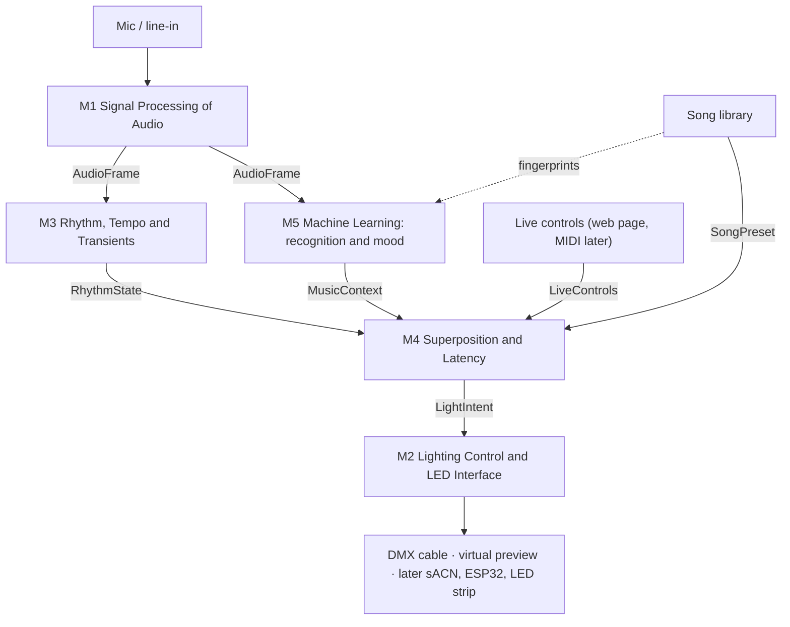

# Architecture

How the five modules fit together, and the one rule that lets five people build at once.

## The pipeline

Audio comes in, gets turned into numbers, the numbers get mixed into one look, and the look goes
out to the lights. One **tick** (one step of the pipeline) happens per block of audio: 1024
samples at 44.1 kHz, about 23 ms, so about 43 ticks per second.



Same thing in text: `mic → M1 → (M3, M5) → M4 (+ live controls, + song presets) → M2 → lights`.

## The contract: the only thing modules share

[`lumasync/contract.py`](../lumasync/contract.py) defines the **feature stream**: a small set of
Python data types that modules read and write. A module may use these types and nothing else
from another module. No module imports another module's code.

That is what lets us work in parallel. You can build and test your module against fake or
recorded data in the contract's format, without waiting for anybody.

| Type | Made by | Read by | What it says |
|---|---|---|---|
| `AudioFrame` | M1 | M3, M5 | One block of audio: the samples, loudness (`rms`), energy in six bands (`sub` … `high`, each 0–1), the spectrum, **spectral centroid** (how "bright" the sound is) and **spectral flux** (how much the spectrum changed since the last block). |
| `RhythmState` | M3 | M4 | Tempo (`bpm`, 0 = not locked yet), `beat` (true on the tick a beat lands), `beat_phase` (0–1 between beats), `onset` strength, `energy_trend` (rising or falling), `drop`, and `confidence`. |
| `MusicContext` | M5 | M4 | Which library song this is (`song_id`, `song_confidence`), and mood as **valence** (sad ↔ happy) and **arousal** (calm ↔ intense), each −1 to 1, or `None` when there is no estimate. |
| `LiveControls` | web page (MIDI later) | M4 | Master brightness, reactivity, how much a song's preset overrides the live show (`preset_blend`), strobe on/off, blackout, and a manual "this song is playing" override. |
| `SongPreset` | song library | M4 (and M5 for fingerprints) | A planned look for one song: 2–3 colours, energy, strobe allowed, an optional per-song blend. |
| `LightIntent` | M4 | M2 | **What** each light should look like (colour, dimmer, strobe rate, each 0–1). Never which DMX channel. |

`LightIntent` is **rig-agnostic**: it does not know what lights are plugged in. M2 maps it to real
channels with a fixture **patch file** (a list of each light's type, mode and start address).
That is how one show runs on any rig.

**Check:** the contract header lists `AudioFrame` going to M3 and M5 only. If M4's base show reads
band energy straight from `AudioFrame`, the header should say so. Raise it as a contract comment
fix.

**Changing the contract** changes every module. It goes through an issue and a pull request
labelled `contract`, and every owner approves. Adding a new optional field (with a default) is
cheap. Renaming or removing one is not. The full process is in [AGENTS.md](../AGENTS.md) §5.

## Testing a module alone

[`lumasync/fakes.py`](../lumasync/fakes.py) makes fake data for each contract type (see the file
for exactly what exists). The pattern:

- **M1:** feed recorded audio files in, check the `AudioFrame`s that come out.
- **M3, M5:** feed fake or recorded `AudioFrame`s in. Compare against labelled data.
- **M4:** feed fake `RhythmState`, `MusicContext` and `LiveControls` in; check `LightIntent` out
  (including that the flash cap holds for any input).
- **M2:** feed fake `LightIntent` in; watch the virtual preview, then a real light.

Recording a real night (audio plus the output) gives every module the same test data.

## The latency budget

People notice when sound leads the picture by more than about **45 ms** (ITU-R BT.1359-1). For
us, the "picture" is the light. The total delay is the sum of every stage:

```
D = D_capture + D_analysis + D_mix + D_output + D_fixture
```

A rough first count (our arithmetic; it must be measured):

| Stage | Rough cost | Why |
|---|---|---|
| Capture | ~23 ms + the sound card's own buffer | Waiting to fill one 1024-sample block |
| Analysis (M1, M3) | a few ms | Must be measured per block |
| Mixing (M4) | under 1 ms | Should be tiny |
| Output (M2) | up to ~33 ms wait + ~23 ms to send | At 30 frames/s a new frame starts every 33 ms; a full 512-channel DMX frame takes about 23 ms on the wire |
| The light itself | unknown | Measure it |

Worst case this is well over 45 ms. That is why the design has three tricks:

1. **Fast and slow paths.** Beats and flashes run on a short path. Mood and recognition change
   over seconds, so they run separately and can never hold up a flash.
2. **Predict the beat.** Beats are regular, so M3 can say when the next one will land, and the
   cue can be sent early. This hides the delay for steady rhythms.
3. **Measure and calibrate.** Measure the real end-to-end delay and correct for it. Smaller
   options exist too: send only the channels in use (112 at Resonnce takes about 5 ms), or a
   faster frame rate.

One more effect worth measuring: sound travels about 343 m/s, so a dancer 10 m from the speakers
hears the beat about 29 ms late, while light arrives at once. That hides some of our delay for
most of the room.

## The output layer

- **Now: a USB-to-DMX cable** (FTDI type). Cheap and simple. The laptop makes the DMX timing
  itself, so it can flicker under load. Fine for tests and for learning the rig. See
  [HARDWARE.md](HARDWARE.md).
- **Next: an ESP32 node.** The laptop sends **sACN** (DMX inside ordinary network packets). An
  ESP32 board with an **isolated** DMX adapter turns it into DMX with steady timing. A second
  ESP32 running WLED (free LED firmware) turns the same packets into LED strip light.
- **Always: one patch file per rig.** Fixture layouts come from Open Fixture Library profiles (a
  free library of light definitions). A new rig is a new patch file.

The flash-rate cap (no more than 3 flashes per second) applies to the **final combined output**,
so no mix of inputs can get past it. See
[decisions/006-flash-rate-cap.md](../decisions/006-flash-rate-cap.md).

## How the prototype maps to the modules

The prototype is a **first draft built for the team** so the whole chain runs end to end from day
one. Each module's folder holds that module's piece of the draft. Each owner now takes their
piece and makes it their own: replace it, measure it, improve it.

| Module | The draft piece (intent; see the code for detail) |
|---|---|
| M1 | Reads the mic or line-in in blocks, computes loudness, band energy, centroid and flux. |
| M3 | A simple live beat and tempo tracker from the flux. |
| M5 | Recognises songs from the library by **audio fingerprint** (a compact "signature" of a recording that can be matched against a live recording). Mood is at most a placeholder so far. |
| M4 | Mixes the base show, the song presets and the live controls into one look, and applies the safety limits. |
| M2 | Maps the look onto real channels through a patch file, and sends DMX to the cable or to the on-screen preview. |

The web page at http://localhost:8765 is shared app code that shows the preview and the live
controls. It is not a module. Design choices made while building the draft are in
`decisions/1xx` files.
